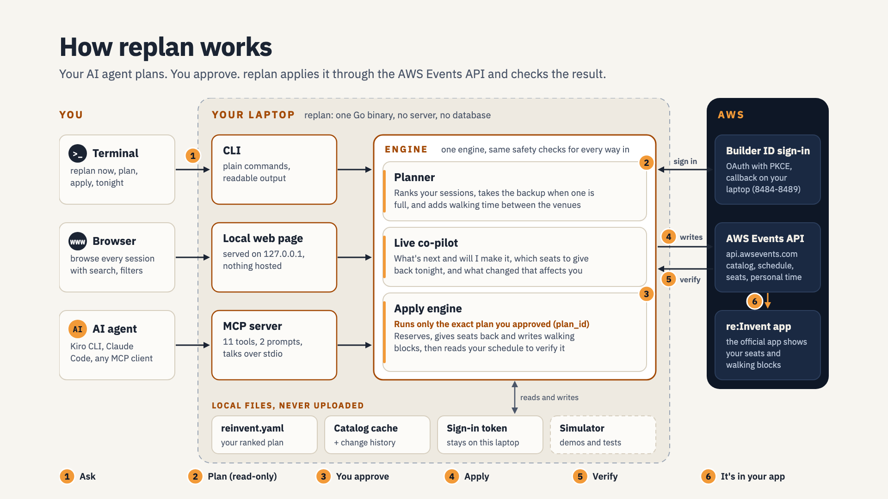
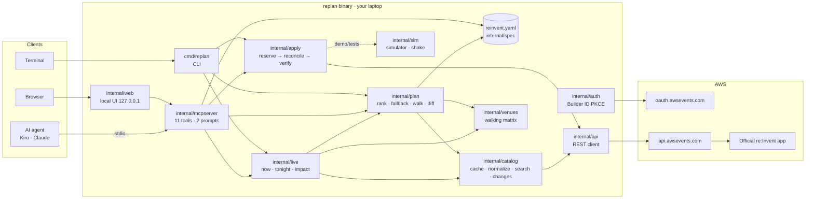
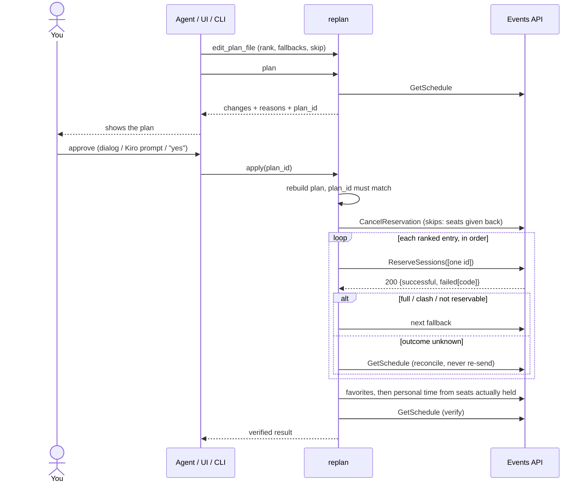
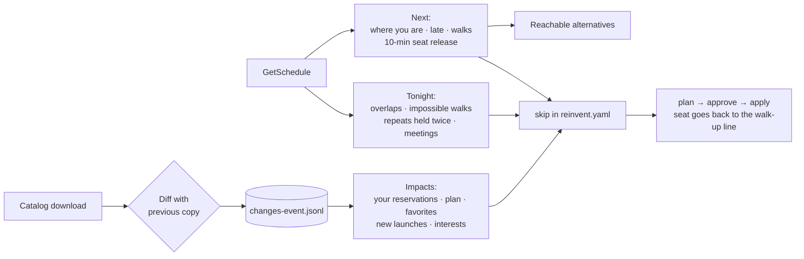

# replan technical architecture

replan is a single Go binary that runs on the attendee's machine. It keeps the attendee's
re:Invent schedule in step with a plan file, safely, through the AWS Events API. It serves three
front ends: a CLI, a local browser UI, and an MCP server for AI agents.

## 1. Constraints that shaped it

| AWS Events API fact | Consequence |
|---|---|
| Sign-in is OAuth with PKCE, redirect only to `127.0.0.1/localhost:8484–8489`, no hosted option | Everything runs locally: no backend, no database, no shared tokens |
| Bulk writes return `200` with per-session failures; no idempotency key | Reserve one session per request, read every failure, reconcile unknown outcomes from `GetSchedule`, verify at the end |
| `CreatePersonalTime` returns 204 with no ID | Tag managed blocks (`[replan:key]`) so later runs can find, update and dedupe them |
| No search or filter; no change feed | Local catalog cache, search and facets; a locally recorded change history |
| Personal time is UTC with 5-minute lengths; sessions use local time; some event time zones are wrong | Normalize all times; trust each session's own time zone |
| 409 while an operation is closed; 429 with `Retry-After`; per-session quotas | Typed errors; honour `Retry-After`; keep going with favorites and blocks when reservations are closed |

## 2. Components

The browser UI is an MCP client of the same server (in memory), so the UI, the CLI and agents all
share one set of tools and one set of safety rules.

## 3. Plan → approve → apply

## 4. replan Live data flow

## 5. Safety layers

1. **The agent edits a plan, never seats.** MCP has no raw reserve tool.
2. **Client approval.** `replan setup kiro` never auto-approves `apply`. MCP dialogs, where supported, can't be answered by the model.
3. **Approved-plan fingerprint.** `apply` recomputes the plan and refuses if its `plan_id` differs.
4. **One session per request, every failure code read.** A full session moves to the next fallback.
5. **No blind retries.** Lost responses are reconciled from `GetSchedule`; creates are never re-sent.
6. **Managed markers.** replan only touches personal time it created.
7. **Verification.** A final `GetSchedule` confirms everything that is reported.
8. **Local only.** Tokens are 0600 and sent only to `api.awsevents.com`. The UI listens on 127.0.0.1 with a Host check, a per-run token and a CSP.
9. **Fair use.** No polling or sniping; seats you can't use are suggested for give-back.

## 6. Packages

| Package | Responsibility | Tests |
|---|---|---|
| `internal/api` | REST client, typed errors, throttling, unknown-outcome writes, pagination | 7 |
| `internal/auth` | Builder ID PKCE sign-in, refresh, revoke, token store | – |
| `internal/catalog` | Cache, normalization (kinds, venues, speakers, time zones), search, facets, change diff and history | 3 |
| `internal/venues` | Venue detection from room names, walking matrix | – |
| `internal/spec` | `reinvent.yaml` schema, validation, save with backup | – |
| `internal/plan` | Greedy rank-order allocation, walking blocks, personal-time diff, `plan_id` | 7 |
| `internal/apply` | Execute, fall back, reconcile, verify; blocks from seats actually held | 5 |
| `internal/live` | Next, Tonight, Impacts | 5 |
| `internal/mcpserver` | 11 MCP tools, 2 prompts, approval flow | 8 |
| `internal/web` | Local browser UI (embedded, no build step) over in-memory MCP | 2 |
| `internal/sim` | Simulator following the documented API behaviour; `Shake` for demos | via others |
| `internal/setup` | Kiro agent and Claude Code configuration | 3 |
| `cmd/replan` | CLI | smoke test |

About 8,200 lines of Go and 41 tests, including an in-memory MCP client, the binary over stdio
(`REPLAN_SMOKE=1`), and real Kiro CLI sessions recorded during development.

## 7. Key decisions

| Decision | Why |
|---|---|
| Desired state in a file, Terraform style | It can be reviewed, diffed and edited by humans and agents, and re-runs only fix what's off |
| Greedy allocation in rank order, not an optimizer | Explainable: every skipped candidate has a one-line reason |
| Walking blocks as personal time | It's the only way to put guidance into the official app people already carry |
| `skip` instead of a raw cancel tool | Giving seats back goes through the same plan → approve → apply loop |
| A simulator that follows the docs | Anyone, and the tests, can exercise full sessions, clashes, 409s and lost responses without touching a real schedule |
| Time travel (`--now`) and `sim shake` | The event happens after the deadline, so the week has to be demonstrable beforehand |
| The UI as an MCP client | One code path for every front end, so the safety rules can't drift between them |
